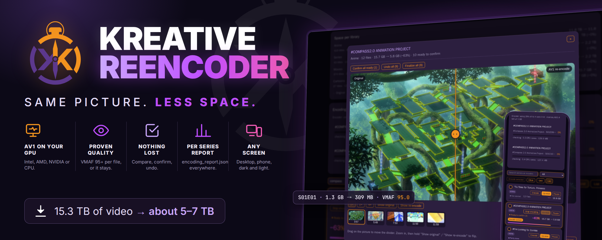
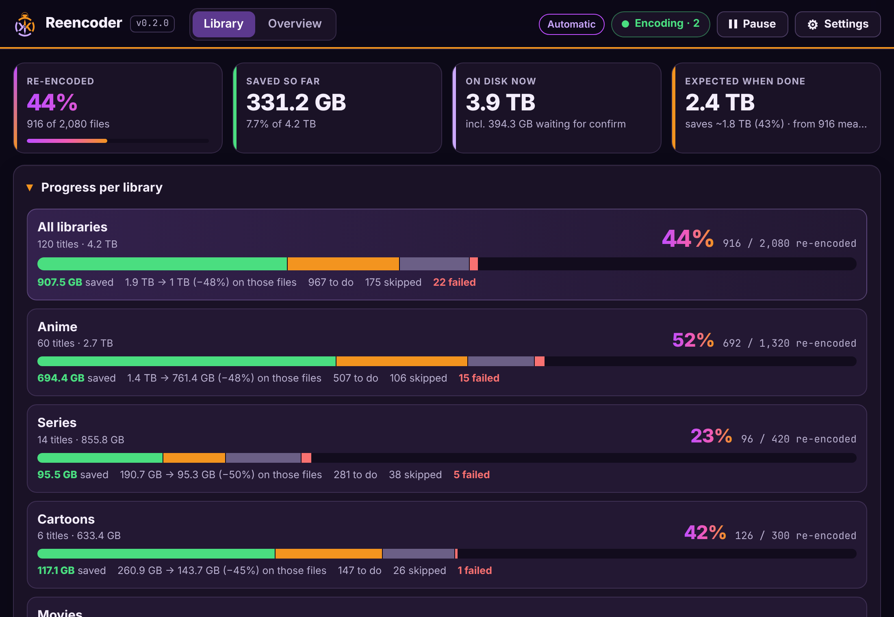
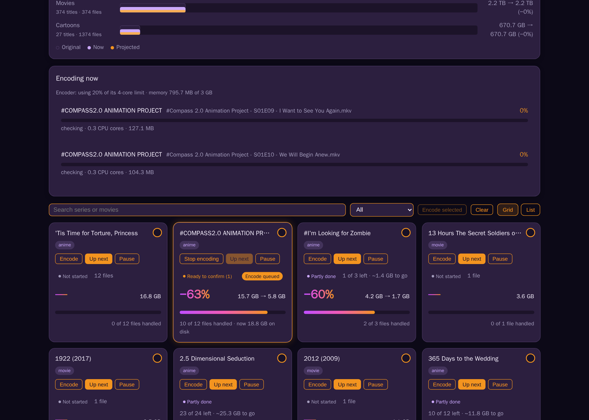
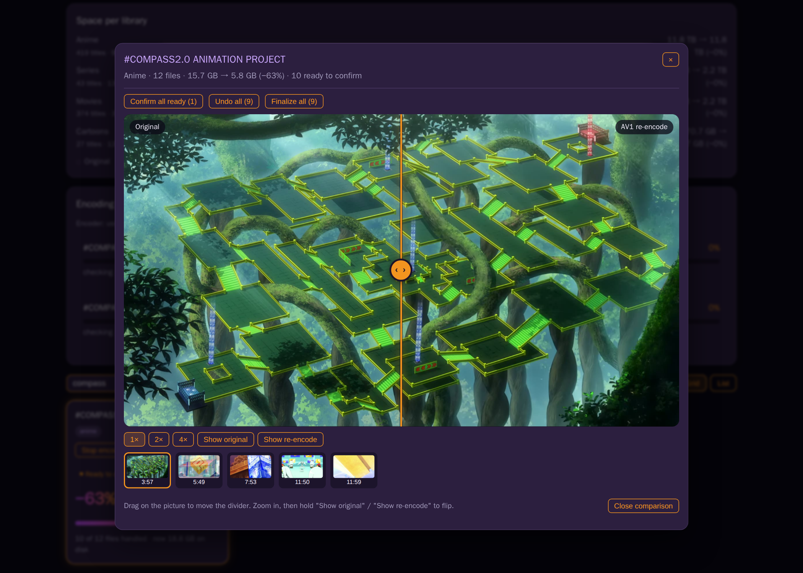
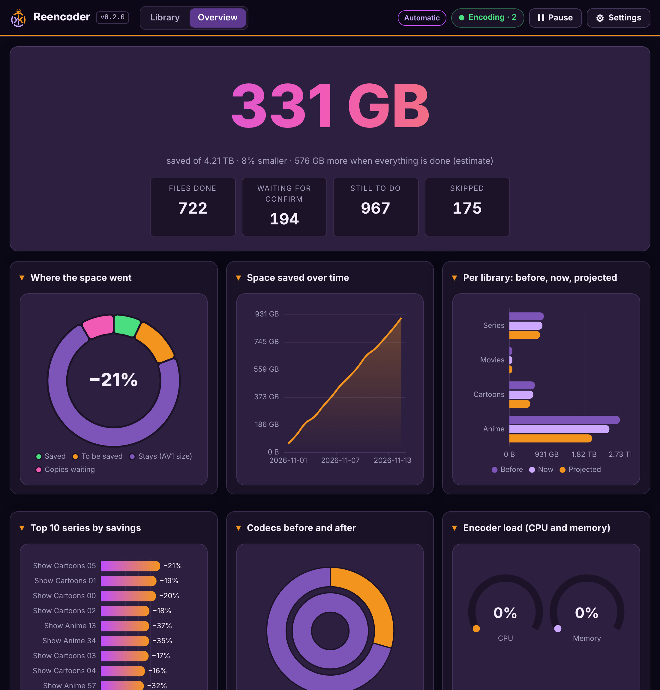
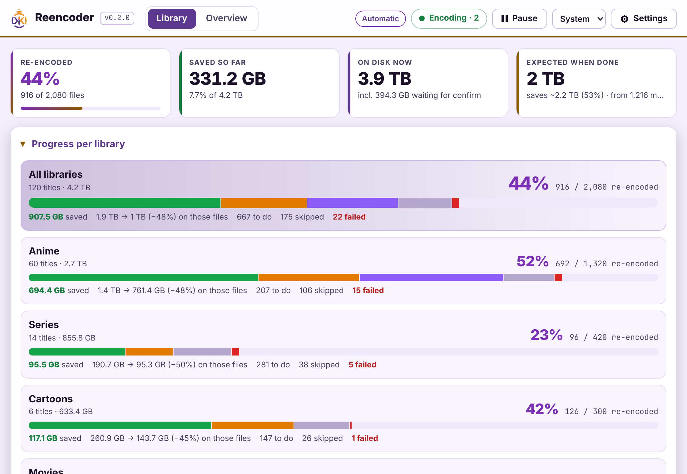
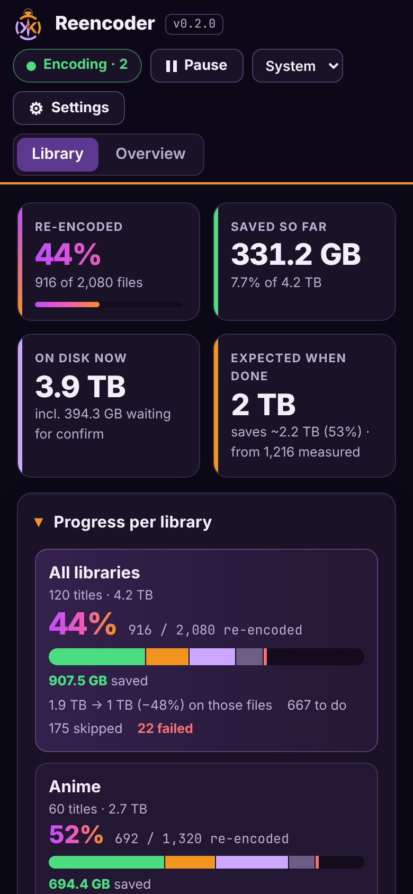

<p align="center">
  
</p>

# Kreative Reencoder

A self-hosted service that re-encodes a video library to AV1 only where a VMAF search proves the result keeps the quality (VMAF >= 95 by default) at a clearly smaller size. Nothing is replaced until you compare and confirm.

Main repository: [git.kreative-kompas.com/khyretos/kk-reencoder](https://git.kreative-kompas.com/khyretos/kk-reencoder), mirrored to [github.com/Khyretos/kk-reencoder](https://github.com/Khyretos/kk-reencoder).

## Screenshots

| | |
|---|---|
|  |  |
| Library: totals, progress per library and what is encoding now | Every series with its status, saving and what is left |
|  |  |
| Compare original and AV1 frames: divider, zoom, hold to flip | Overview: where the space went, savings over time, encoder load |
|  |  |
| Light theme (also Grey and Dark) | On a phone |

The library, overview, light and phone screenshots show demo data; series and compare come from a real library. `docs/screenshots/shoot.mjs` takes them again from a running instance.

## Features

- **Proves the quality before it saves space.** Every file is measured with VMAF against its original; only a copy that keeps the target quality (95 by default) and comes out smaller is kept.
- **Nothing is replaced behind your back.** Copies wait in a hidden `.reencoder` folder next to the original. You Compare, Confirm (undo stays possible), then Finalize, which is the only step that deletes an original.
- **Uses the hardware you have.** Intel Quick Sync, AMD and Intel VA-API, NVIDIA NVENC, or the CPU (SVT-AV1). `auto` finds and tests it at start-up.
- **One page for the whole library:** progress per library (files re-encoded out of the total, %, space saved), what is encoding now, a queue you can drag to reorder, filters (ready to confirm, ready to finalize, failed, skipped), and an overview with charts.
- **Bulk actions:** tick series (or none, for every series the filter shows) and Confirm ready, Finalize, Retry failed, Retry skipped, Encode or Up next in one click.
- **Retry anything:** failed and skipped files go back to the front of the queue, one by one, per series or in bulk. Files that are already AV1, or that a setting still leaves out, say so instead.
- **Pause that really pauses:** running encodes are frozen where they are and carry on after Resume; the button, the status and a banner turn amber while paused.
- **Settings on the page:** mode, encoder, encodes at once, quality target, size limit, samples, codecs, largest resolution, HDR, GPU decode, GPU quality scoring, staging space and rescan interval. They apply at once and survive restarts.
- **Themes:** System, Dark, Light (Kreative Kompas) and Grey (plain neutral), per browser. Works on phones.
- **Reports:** `encoding_report.json` per series, savings over time, live CPU and memory per job.

## Quick start

You need Docker with Compose v2.24 or newer. A GPU is optional.

```bash
git clone https://github.com/Khyretos/kk-reencoder.git && cd kk-reencoder
cp .env.example .env            # optional: every value has a default
# point it at your media: set RX_MEDIA_DIR in .env, or edit the volumes in docker-compose.yml
docker compose up -d --build
```

Open http://127.0.0.1:8080. It starts in **Report** mode: it scans and measures what AV1 would save, and changes nothing. When you like what you see, open Settings and pick **Manual** (only the series you tick) or **Automatic** (everything that qualifies).

**Without cloning:** download only `docker-compose.yml`, put `RX_BUILD_CONTEXT=https://github.com/Khyretos/kk-reencoder.git` in a `.env` next to it (with `RX_MEDIA_DIR`), and run the same `docker compose up -d --build`. Compose builds the image straight from git.

### Media folders

Every folder directly under `/media` in the container is one library (Movies, Series, Anime, ...). Inside a library, each title folder is one series or movie; season folders count as part of their series.

- One host folder that holds all your libraries: `RX_MEDIA_DIR=/srv/media`.
- Libraries on different disks: one volume line each in `docker-compose.yml`, for example `- /mnt/disk1/Movies:/media/Movies` and `- /mnt/disk2/TV:/media/Series`.
- Only some folders: `RX_ROOTS=/media/Movies,/media/Series`.

The container runs as `RX_UID:RX_GID` (default 1000:1000). Set them to the owner of your media (`id -u`, `id -g`): in Manual and Automatic mode it writes the `.reencoder` folders next to the originals.

### GPU

Copy `docker-compose.override.example.yml` to `docker-compose.override.yml` and keep the part for your card:

| Hardware | Encoder | What to pass in | Notes |
| :--- | :--- | :--- | :--- |
| Intel Arc, Core Ultra (Meteor Lake) and newer | `qsv` (`av1_qsv`) | `/dev/dri/renderD128` + render group (`RX_RENDER_DEVICE`, `RX_RENDER_GID`) | Tested most. Full-GPU path: decode, 10-bit conversion and encode on the GPU. |
| AMD Radeon RX 7000 (RDNA 3) and newer | `vaapi` (`av1_vaapi`) | same as Intel | Mesa's radeonsi driver is in the image. |
| NVIDIA RTX 40 and newer | `nvenc` (`av1_nvenc`) | the `deploy.resources` block | Needs the NVIDIA Container Toolkit on the host. |
| No GPU, or an older one without AV1 encode | `svt` (`libsvtav1`) | nothing | Works everywhere, much slower. |

With `RX_ENCODER=auto` (the default) the service lists the render nodes it can see, reads each card's vendor, and runs a one-second test encode on each candidate (Intel: Quick Sync, then VA-API; then NVIDIA; then AMD), falling back to the CPU. The log and Settings > About this install show what it found and chose. Set `RX_ENCODER` (or pick it in Settings) to force one.

### Reverse proxy

The port is published on `127.0.0.1:8080` only (`RX_BIND`, `RX_HOST_PORT`). To serve it through a proxy on the same Docker network, use the proxy part of the override example (it joins `RX_PROXY_NETWORK` and publishes no port) and point the proxy at `reencoder:8080`. The service has no login of its own: put it behind your proxy's sign-in before opening it to the network.

### Update and remove

Update: `git pull && docker compose up -d --build` (or just `docker compose up -d --build` with a git build context). Remove: `docker compose down`; add `-v` to also delete the database and reports. Your media and any `.reencoder` folders stay.

## How it works

1. **Scan.** It walks every library in alphabetical order and reads each video with ffprobe. It skips files that are already AV1, Dolby Vision profile 5, HDR (unless you turn "Skip HDR videos" off), a codec you did not select, or taller than the largest resolution. Every skip says why on the page.
2. **Quality search.** For a file it cuts 3 samples of 20 s, makes a lossless reference of each (Ut Video / FFV Huffyuv), encodes them to AV1 at several quality levels and scores every one with VMAF (libvmaf; on an Intel Arc GPU with the `kk-vmafx` base image). It picks the smallest encode that reaches the target VMAF and is at most the size limit (95% of the original by default). Files that are already small for their resolution are searched at VMAF 97 so they keep everything they have.
3. **Reuse.** After 2 files of a series it knows the series' quality level; later episodes get one check sample instead of a full search (or none with "Check every episode" off).
4. **Encode.** The whole file is encoded with that quality. Video becomes 10-bit AV1; audio, subtitles, chapters and attachments are copied as they are. HDR10 and HLG keep their colour data. The copy is checked: AV1, same length, smaller than the original, HDR still HDR.
5. **Stage, compare, confirm, finalize.** The copy waits in `.reencoder/` with comparison frames. Confirm swaps it in and keeps the original; Undo swaps back; Finalize deletes the kept original. In Report mode it only records what the copy would weigh.

### ffmpeg

The image pins ffmpeg 8.1 from BtbN's static GPL builds (checked by sha256; `FFMPEG_*` build args in the Dockerfile). Per backend the encode looks like this (`q` is the quality the search found):

| Encoder | Video arguments |
| :--- | :--- |
| `qsv` | `-c:v av1_qsv -preset veryslow -global_quality q -extbrc 1 -look_ahead_depth 40`, with `-hwaccel qsv` decode when `RX_HW_DECODE=true` |
| `vaapi` | `-vf format=p010le,hwupload -c:v av1_vaapi -rc_mode ICQ -global_quality q` |
| `nvenc` | `-c:v av1_nvenc -preset p7 -tune hq -rc vbr -cq q -b:v 0` |
| `svt` | `-c:v libsvtav1 -preset 6 -crf q` |

Every ffmpeg runs at the lowest CPU and IO priority (nice 19, ionice idle) with a thread cap (`RX_FFMPEG_THREADS`), so the host and the page stay responsive.

### Encodes at once

"Encodes at once" (1 to 5, default 2) sets how many files are worked on in parallel. Most GPUs have one or two encoder engines, and the quality check uses the CPU, so more than 2 rarely helps; on the CPU encoder, 1 is usually best. Memory: plan about 1 GB per running file (`RX_MEM_LIMIT`, default 3g), `RX_CPUS` caps the CPU (default 4).

## Settings

Most settings are on the Settings screen; what you save there is stored in the database and wins over `.env`. Everything can also be set in `.env` (`.env.example` lists them all, with the host settings `RX_MEDIA_DIR`, `RX_UID`, `RX_GID`, `RX_RENDER_DEVICE`, `RX_RENDER_GID`, `RX_PROXY_NETWORK`, `RX_BIND`, `RX_HOST_PORT`, `RX_IMAGE`, `RX_BUILD_CONTEXT`, `RX_MEM_LIMIT`, `RX_CPUS`, `TZ`).

| Variable | Default | Description |
| :--- | :--- | :--- |
| `RX_ROOTS` | every folder in `/media` | Comma list of library folders inside the container. |
| `RX_MODE` | `report` | `report` (measure only), `manual` (only series ticked on the page are encoded) or `stage` (encode everything that qualifies). |
| `RX_ENCODER` | `auto` | `auto` (find and test the GPU, else CPU), `qsv`, `vaapi`, `nvenc`, `svt`. Also on the Settings screen. |
| `RX_DEVICE` | `/dev/dri/renderD128` | GPU render node for `qsv`/`vaapi` (auto picks the node it tested). |
| `RX_LIBVA_DRIVER` | automatic | VA-API driver name when the automatic one (iHD for Intel, radeonsi for AMD) is wrong. |
| `RX_TARGET_VMAF` | `95` | Target VMAF score. |
| `RX_MAX_RATIO` | `0.95` | Max output size ratio (0.95 = keep anything that saves 5% or more; up to 0.99). |
| `RX_PARALLEL` | `2` | Number of concurrent encodes (1-5). |
| `RX_HW_DECODE` | `true` | QSV only: decode and 10-bit conversion on the GPU too (about 5x faster); falls back to CPU decode per file. |
| `RX_FILTERS` | (none) | Optional CPU filters per library, e.g. `Anime=deband`. |
| `RX_MAX_STAGED_GB` | `1000` | Pause staging if total exceeds this. |
| `RX_VMAF_THREADS` | `4` | Threads for VMAF analysis. |
| `RX_VMAF_GPU` | `auto` | With the `kk-vmafx` base image: score VMAF on the Intel GPU (libvmaf_sycl, every frame) for videos of 720p and up. The first GPU score of each start is compared with the CPU's on the same sample and the GPU is used only when they match; `off` keeps it on the CPU. |
| `RX_BASE_IMAGE` | `debian:trixie-slim` | Build arg. `kk-vmafx:local` (build it in the [kk-vmafx](https://git.kreative-kompas.com/khyretos/kk-vmafx) repo first) adds the Intel GPU runtime and VMAFx's ffmpeg for GPU VMAF. |
| `RX_FFMPEG_THREADS` | `2` | Threads per ffmpeg decoder, encoder and filter graph. ffmpeg otherwise starts one per host CPU, which overloads a CPU-limited container and can run it out of memory. |
| `RX_SAMPLES` | `3` | Number of samples per file. |
| `RX_SAMPLE_LEN` | `20` | Length of each sample in seconds. |
| `RX_SKIP_HDR` | `true` | Skip HDR files. Also on the Settings screen. Off: HDR10/HLG stay HDR, Dolby Vision keeps its HDR10 picture. |
| `RX_CODECS` | `h264,hevc,mpeg4,vc1,mpeg2video,wmv3,msmpeg4v3` | Source codecs to consider (AV1 is always skipped). |
| `RX_MAX_HEIGHT` | `2160` | Skip taller videos. |
| `RX_RESCAN_S` | `86400` | Rescan the library every N seconds (once a day), in the background. Also on the Settings screen. |
| `RX_CHECK_EVERY_EPISODE` | `true` | `false`: once a series has its quality, later episodes skip the CPU check sample. Also on the Settings screen. |
| `RX_SEARCH_PER_FOLDER` | `2` | Files to search per series before locking quality. |

## Customising the page

The page is plain HTML, CSS and JavaScript in `app/static/`, with no build step: edit and reload (rebuild the image to ship it).

- **Colours:** every colour is a CSS variable at the top of `style.css` (`--kk-*` brand colours, `--rx-*` surfaces and states). The Grey theme at the end of the file shows how to make your own palette: copy its `html[data-theme="grey"]` block, change the values, and add the name to `THEMES` in `theme.js`.
- **Layout:** `index.html` (library page) and `overview.html` hold the panels; every panel with a heading folds by itself (`fold.js`).
- **Pieces:** `shell.js` (header, run state, Pause/Resume), `progress.js` (progress per library), `app.js` (tiles, series list, bulk bar), `detail.js` (series window), `queue.js`, `settings.js`, `overview.js` (charts, Apache ECharts).
- **API:** everything the page shows comes from JSON endpoints in `app/server.py` (`/api/status`, `/api/libraries`, `/api/folders`, `/api/queue`, `/api/settings`, `/api/bulk`, ...), so you can script it too.

## Safety

- Originals are never replaced without Confirm, and Finalize is the only delete.
- The space guard (`RX_MAX_STAGED_GB`, "Space for copies waiting for confirm") pauses new encodes when copies waiting for Confirm and kept originals take more than that.
- A copy that is not AV1, not the same length, not smaller, or lost its HDR data is never kept.
- No login of its own: keep it on localhost or behind a proxy with sign-in.

## Development

```bash
python3 -m unittest discover tests     # unit tests (no GPU needed)
tests/ui/run-check.sh                  # browser check against a running instance
docs/benchmarks-abtest.sh              # quality/size per quality level on sample files
```

## Credits and licences

ffmpeg is the BtbN static GPL build, with libvmaf by Netflix and SVT-AV1. Apache ECharts 5.5.1 is bundled (Apache-2.0, see `app/static/ECHARTS-LICENSE.txt`). The VMAF-search idea comes from ab-av1. Project licence: see LICENSE.
