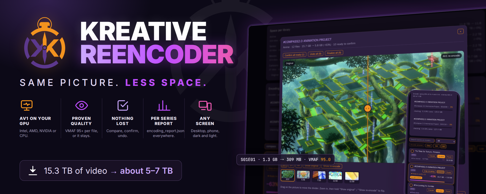
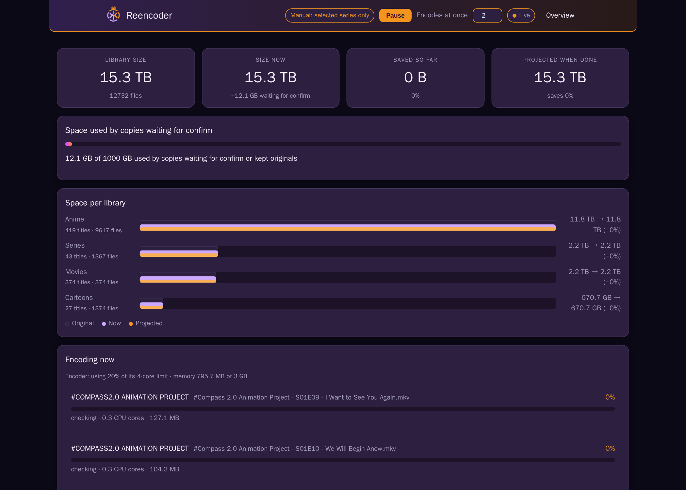
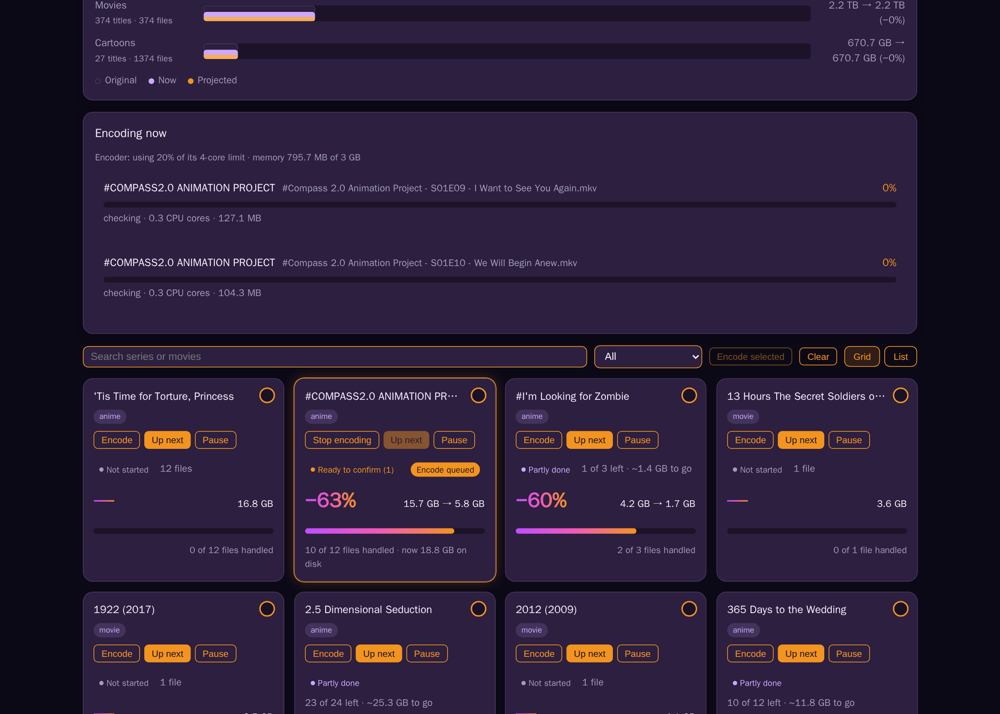
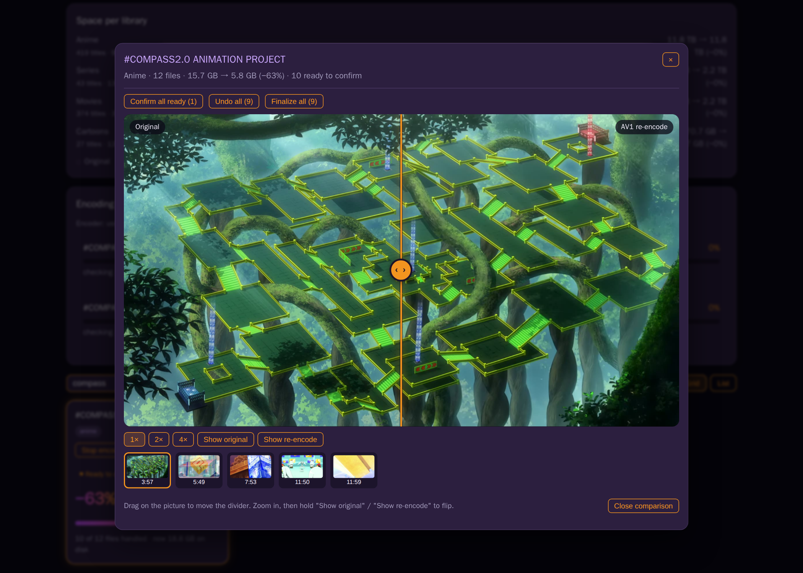
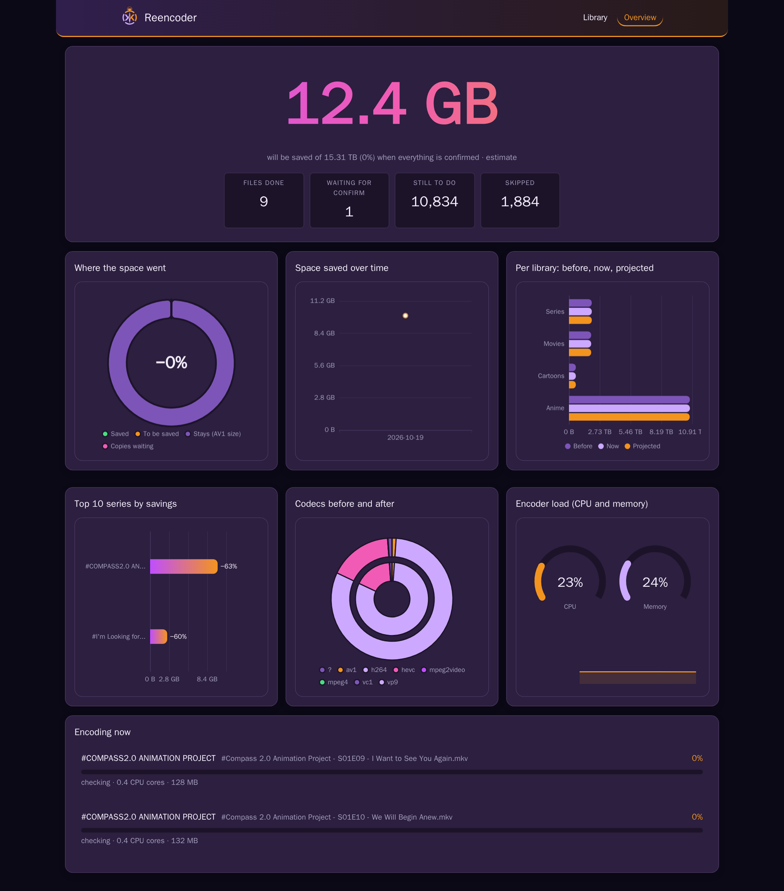
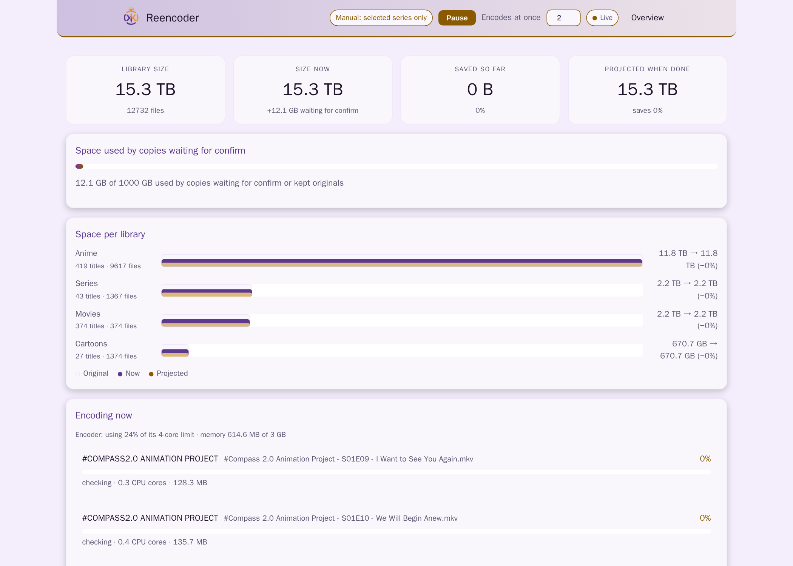
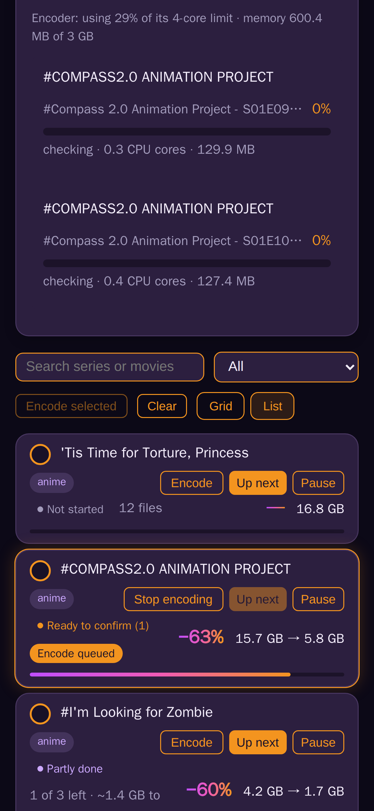

<p align="center">
  
</p>

# Kreative Reencoder

A self-hosted service that re-encodes a video library to AV1 only where a VMAF search proves the result keeps the quality (VMAF >= 95 by default) at a clearly smaller size. Nothing is replaced until you compare and confirm.

Main repository: [git.kreative-kompas.com/khyretos/kk-reencoder](https://git.kreative-kompas.com/khyretos/kk-reencoder), mirrored to [github.com/Khyretos/kk-reencoder](https://github.com/Khyretos/kk-reencoder).

## Screenshots

| | |
|---|---|
|  |  |
| Library: totals, space per library and what is encoding now | Every series with its status, saving and what is left |
|  |  |
| Compare original and AV1 frames: divider, zoom, hold to flip | Overview: where the space went, savings over time, encoder load |
|  |  |
| Light theme | On a phone |

The screenshots come from a real library. `docs/screenshots/shoot.mjs` takes them again from a running instance.

## Features

- **AV1 on Intel QSV** with full-GPU path (decode, 10-bit conversion, encode).
- **Hardware acceleration** via VAAPI, NVENC or CPU SVT-AV1.
- **VMAF-proven quality** per file; nothing replaces the original without confirmation.
- **Modes**: report (measure only), manual (tick series to encode), stage (encode next to original).
- **Batch control**: pause, priorities, 1-5 encodes at once.
- **Queue**: see which series are encoded or measured next; drag to reorder (mouse or finger), send one to the front, take it out and put it back.
- **Settings screen**: mode (report, manual, automatic), encodes at once, daily rescan, quality target and size limit, without editing the compose file.
- **Staged copies** in a hidden `.reencoder` folder; Compare, Confirm, Undo, Finalize steps.
- **Safety**: originals are never deleted before Finalize; space guard (`RX_MAX_STAGED_GB`).
- **Reports**: `encoding_report.json` per series; overview with charts; live CPU/memory per job.
- **Scans** in the background (daily, per library or per series); works on phones, dark and light themes.
- **Glance or detail**: every panel folds to a one-line summary of its numbers; cards and rows are coloured by state (done, ready to confirm, partly done, queued, running, skipped).

## How it works

The service scans library folders in alphabetical order. It identifies series and movies by title folder; season folders are counted as part of their series.

It skips files that are already AV1, HDR (by default), low-bitrate, or use unselected codecs.

For each file:
1. It cuts 3 x 20 s samples.
2. It makes a lossless reference.
3. It encodes them at several quality levels.
4. It scores them with VMAF.
5. It picks the smallest encoding that reaches the target and is at most 80% of the original size.

After searching 2 files per series, the service reuses that quality setting with one check sample for the rest of the series.

## Quick start

Copy `docker-compose.example.yml` to `docker-compose.yml`, adjust the lines marked ADJUST (media folders, user, GPU) and run `docker compose up -d`. Open http://127.0.0.1:8080. Note it has no login of its own: put it behind your reverse proxy with sign-in before exposing it.

```yaml
services:
  reencoder:
    build: .
    container_name: kk-reencoder
    restart: unless-stopped
    user: "1000:1000"            # ADJUST: uid:gid that owns your media files
    group_add:
      - "993"                     # ADJUST: your render group
    devices:
      - /dev/dri/renderD128:/dev/dri/renderD128   # ADJUST: your GPU
    volumes:
      - /srv/media/Anime:/media/Anime
      - /srv/media/Movies:/media/Movies
      - /srv/media/Series:/media/Series
      - reencoder-data:/data
    ports:
      - "127.0.0.1:8080:8080"
    environment:
      - RX_ROOTS=/media/Anime,/media/Movies,/media/Series
      - RX_MODE=manual
      - RX_ENCODER=qsv
      - RX_DEVICE=/dev/dri/renderD128
      - RX_HW_DECODE=true
      - RX_PARALLEL=2
      - RX_TARGET_VMAF=95
      - RX_MAX_RATIO=0.8
      - RX_FILTERS=
      - RX_SAMPLES=3
      - RX_SAMPLE_LEN=20
      - RX_SEARCH_PER_FOLDER=2
      - RX_MAX_STAGED_GB=1000
      - TZ=Europe/Amsterdam
    mem_limit: 3g
    cpus: 4
    cpu_shares: 128
    pids_limit: 256
    security_opt:
      - no-new-privileges:true
    cap_drop:
      - ALL

volumes:
  reencoder-data:
```

Notes:
- Find your render group ID with `getent group render`.
- Mount media as `:ro` for report mode, read-write for stage mode.
- Put the service behind a sign-in page; it has no login of its own.

## Settings

| Variable | Default | Description |
| :--- | :--- | :--- |
| `RX_ROOTS` | every folder in `/media` | Comma list of library folders inside the container. |
| `RX_MODE` | `report` | `report` (measure only), `manual` (only series ticked on the page are encoded) or `stage` (encode everything that qualifies). |
| `RX_ENCODER` | `qsv` | `qsv`, `vaapi`, `nvenc`, `svt`. |
| `RX_DEVICE` | `/dev/dri/renderD128` | GPU device path. |
| `RX_TARGET_VMAF` | `95` | Target VMAF score. |
| `RX_MAX_RATIO` | `0.8` | Max output size ratio (0.8 = 80%). |
| `RX_PARALLEL` | `2` | Number of concurrent encodes (1-5). |
| `RX_HW_DECODE` | `true` | QSV only: decode and 10-bit conversion on the GPU too (about 5x faster); falls back to CPU decode per file. |
| `RX_FILTERS` | (none) | Optional CPU filters per library, e.g. `Anime=deband`. |
| `RX_MAX_STAGED_GB` | `1000` | Pause staging if total exceeds this. |
| `RX_VMAF_THREADS` | `4` | Threads for VMAF analysis. |
| `RX_SAMPLES` | `3` | Number of samples per file. |
| `RX_SAMPLE_LEN` | `20` | Length of each sample in seconds. |
| `RX_SKIP_HDR` | `true` | Skip HDR files. |
| `RX_CODECS` | `h264,hevc,mpeg4,vc1,mpeg2video,wmv3,msmpeg4v3` | Source codecs to consider (AV1 is always skipped). |
| `RX_MAX_HEIGHT` | `2160` | Skip taller videos. |
| `RX_RESCAN_S` | `86400` | Rescan the library every N seconds (once a day), in the background. Also on the Settings screen. |
| `RX_CHECK_EVERY_EPISODE` | `true` | `false`: once a series has its quality, later episodes skip the CPU check sample. Also on the Settings screen. |
| `RX_SEARCH_PER_FOLDER` | `2` | Files to search per series before locking quality. |
| `RX_PORT` | `8080` | Web UI port. |

## Safety

- Originals are never replaced without Confirm.
- Finalize is the only delete.
- The space guard (`RX_MAX_STAGED_GB`) pauses staging if limits are exceeded.
- Runs at the lowest CPU/IO priority.
- One job per GPU engine is fine.

## Development

Run tests:
```bash
python3 -m unittest discover tests
```

Run UI check:
```bash
tests/ui/run-check.sh
```

Run benchmarks:
```bash
docs/benchmarks-abtest.sh
```

Tests include `tests/ui/check.mjs` (browser check) and `tests/ui/phone.mjs` (phone-speed check against a running instance). `docs/benchmarks-abtest.sh` measures quality/size per quality level on sample files.

## Credits and licences

ffmpeg is the BtbN static GPL build, with libvmaf by Netflix. Apache ECharts 5.5.1 is bundled (Apache-2.0, see `app/static/ECHARTS-LICENSE.txt`). The VMAF-search idea comes from ab-av1. Project licence: see LICENSE.
